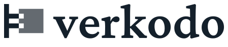

<p align="center">
  <picture>
    <source media="(prefers-color-scheme: dark)" srcset="assets/verkodo-lockup-on-dark.svg">
    
  </picture>
</p>

<p align="center"><b>Truth code – mathematics and law written formally, checked by machine.</b><br>
<sub>a <a href="https://falkoss.org">falkOSS</a> project</sub></p>

**verkodo** writes knowledge down formally instead of as prose – mathematics first, then German and, later, European law. A concept can have several definitions, joined by bridges that prove them equivalent; a lecture, a guide or a commentary is a path through them; Lean 4 checks the proofs. Text, PDF and web pages in any language are generated from it, and every word in them is explained down to its foundations – the links come from the formalisation, nobody sets them by hand. It is for people who teach, learn, write or apply mathematics and law.

verkodo is free software – everything included, no telemetry.

> verkodo is at its beginning: there is nothing to install yet. Start with the
> [whitepaper](https://github.com/verkodo/whitepaper).

### Same rules as falkOSS

- **Free licences** – AGPL-3.0-or-later; contributions with a DCO sign-off, no CLA.
- **Everything included** – one edition, every feature free; no paid tiers, nothing held back.
- **No telemetry** – nothing phones home.
- **In the open** – issues, plans, reviews and decisions happen in public.

### The name

```
vero   truth
kodo   code
       → verkodo
```

*verkodo* joins two Esperanto words: *vero*, truth, and *kodo*, code – a system of signs, and the text of a program. Put together they make a truth code: knowledge written down so that a machine can check that it holds. Both words are in the Reta Vortaro, one of the standard dictionaries; the compound is new. Said ver-KO-do, stressed on the second-to-last syllable like every Esperanto word.

### Repositories

| Repository | What |
|---|---|
| [verkodo](https://github.com/verkodo/verkodo) | the software and its documentation ([verkodo.github.io/verkodo](https://verkodo.github.io/verkodo/)) – `cargo install verkodo` |
| [sciaro](https://github.com/verkodo/sciaro) | the body of knowledge – mathematics and law written in verkodo, sourced and checked by Lean; first: § 19 UStG |
| [brand](https://github.com/verkodo/brand) | the brand kit – logo, colours, icons |
| [whitepaper](https://github.com/verkodo/whitepaper) | the whitepaper – Markdown, set to PDF with Typst |
| [website](https://github.com/verkodo/website) | the landing page ([verkodo.github.io/website](https://verkodo.github.io/website/)) |

<sub>verkodo is free software and a project of <a href="https://falkoss.org">falkOSS</a> – falkOSS – Falcon Lake Open Source Software gUG (haftungsbeschränkt) i. G., from Falkensee.</sub>
